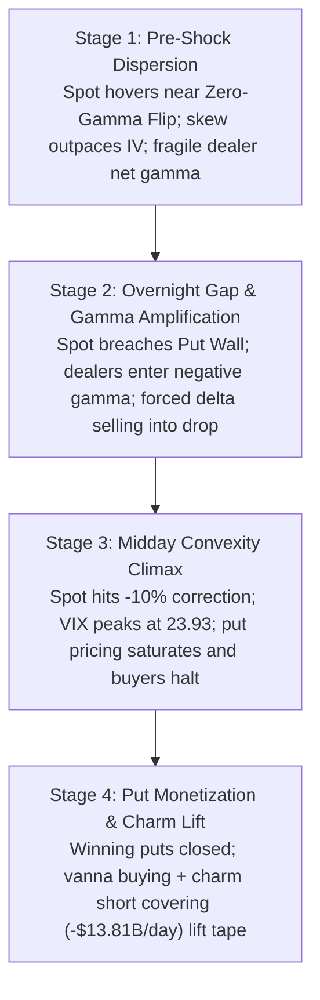

## Overview

On October 30, 2026, the technology sector experienced an acute structural drawdown where the Nasdaq-100 (NDX) plunged to an intraday trough of **28,093.24**, printing an exact **-10.0% correction touch** from its recent record peak before clawing back 291 points to close at 28,384.85 (-3.46%).

The sell-off represented a critical transition in market psychology: equity markets rapidly shifted from rewarding top-line AI expansion to aggressively penalizing capital intensity and free cash flow dilution. However, while fundamental hyperscaler cash-burn repricing initiated the decline, **options market maker positioning and dealer gamma dynamics dictated the velocity, amplitude, and intraday reversal** of the move. An overnight gap beneath the S&P 500 Zero-Gamma Flip (7,699.20) and QQQ $700 Put Wall forced institutional market makers into short gamma, turning dynamic delta hedging into an automated selling accelerator during the morning session until afternoon put monetization, positive vanna, and -$13.81B/day in SPX charm decay halted the cascade.

## Key Microstructure Concepts

- **Zero-Gamma Flip** — The critical price threshold where aggregate dealer gamma flips from positive to negative. Above this level, market makers buy into weakness and sell into strength (volatility dampener); below it, dealers must sell into falling markets and buy into rising markets to maintain delta neutrality (volatility accelerator).
- **Gamma Exposure (GEX)** — The estimated dollar value of underlying shares that options market makers must trade for every 1% change in spot price to remain delta-neutral.
- **Put Wall** — The strike price with the largest concentration of net put gamma. In a negative gamma environment, it acts as an intraday magnet and downside acceleration threshold.
- **Call Wall** — The strike price with the largest concentration of net call gamma, representing structural overhead resistance where dealer short stock selling caps rallies.
- **Vanna ($\partial \Delta / \partial \sigma$)** — The sensitivity of option delta to changes in implied volatility. As IV declines, out-of-the-money put deltas shrink toward zero, compelling short-put dealers to buy back short underlying hedges.
- **Charm ($\partial \Delta / \partial t$)** — The rate of delta decay over time. As options approach expiration ($t \to \text{close}$), decaying out-of-the-money put deltas force market makers into mechanical short-covering.
- **Volatility Skew** — The implied volatility spread between out-of-the-money puts and calls (e.g., 25-delta put IV minus 25-delta call IV), measuring institutional demand for downside tail protection.
- **Tail Premium** — The implied volatility spread of deep out-of-the-money downside puts (10-delta put IV) over at-the-money volatility, reflecting crash probability pricing.
- **0DTE Contracts** — Zero Days to Expiration options that experience extreme gamma convexity and hyper-accelerated charm decay into the closing bell.

## Cross-Asset Session Performance

| Index / Instrument | Oct 29 Close | Oct 30 Open | Intraday Extrema | Oct 30 Close | Net Change |
|---|---|---|---|---|---|
| **Nasdaq-100 (NDX)** | 29,402.85 | ~28,725.00 | 28,093.24 (-10.0%) | 28,384.85 | -3.46% (-1,018.00) |
| **Nasdaq Composite (IXIC)** | 26,184.73 | 25,606.33 | <25,400.00 | 25,437.00 | -2.86% (-747.73) |
| **Invesco QQQ Trust (QQQ)** | $715.31 | <$700.00 | ~$688.50 | $690.49 | -3.47% (-$24.82) |
| **S&P 500 (SPX)** | 7,720.39 | 7,626.38 | 7,580.07 (Low) | 7,580.07 | -1.82% (-140.32) |
| **Cboe Volatility Index (VIX)** | 17.20 | 18.43 | 23.93 (Peak) | 19.41 | +12.91% (+2.22) |
| **Nasdaq-100 VIX (VXN)** | 25.18 | ~26.80 | >30.00 | 28.50 | +13.19% (+3.32) |
| **10-Year US Treasury Yield** | 4.98% | 4.95% | 4.92% (Low) | 4.93% | -5 bps (Flight to quality) |
| **Brent Crude Oil ($/bbl)** | ~$110.77 | >$113.00 | $113.79 | $113.43 | +2.40% (Hormuz strike) |

## Fundamental Catalysts and Flow Bifurcation

The session unfolded in four distinct fundamental and psychological phases:

1. **Hyperscaler Cash Burn Shock:** Alphabet ($GOOGL) triggered the sell-off on October 29 with a 12.6% collapse (-$500B market cap) following negative free cash flow of -$9.1B and missed search estimates due to chatbot diversion. Amazon ($AMZN) compounded the panic by guiding $220B in 2026 capex with higher 2027 commitments, alongside negative operating cash flow.
2. **Hardware Margin Compression:** Intel ($INTC) suffered its worst single-day decline since 1974 (-28.58% to $65.76) as gross margin guidance cratered to 38.0% (vs. 44.1% prior) under soaring PC memory costs and foundry burn.
3. **Exogenous Geopolitical & Digital Shocks:** Brent crude surged above $113/bbl after an explosive tanker strike in the Strait of Hormuz. Simultaneously, a $6B North Korean exploit of Binance sent Bitcoin down 2.42% to $76,835, triggering collateral liquidation across multi-strategy funds.
4. **Flight to Cash-Flow Anchors:** Capital rotated defensively away from capital-destructive hyperscalers into cash-insulated mega-caps. Apple ($AAPL) slipped just 1.23%, overtaking Nvidia ($4.94T) to reclaim the world's #1 market cap spot at $5.03T.

## Intraday Derivatives Evolution

- **Prior Day Close (Oct 29, 4:00 PM ET):** SPX sat at 7,720.39 with its Zero-Gamma Flip at 7,703.20. QQQ closed at $705.38 above its key $700 Put Wall. Dealer positioning was fragile but nominally positive.
- **Morning Open (08:15 – 10:30 AM ET):** Futures gapped down. Spot crossed beneath the SPX Zero-Gamma Flip to open at 7,624.99. The SPX Put Wall broke down from 7,700 to 7,600, while QQQ plunged below $700. Short gamma took hold; 0DTE put volume surged (put/call ratio at 1.701), forcing dealers to dump index futures into the drop.
- **Midday Convexity Climax (11:30 AM – 1:30 PM ET):** NDX touched 28,093.24 (-10.0% correction). VIX exploded to an intraday high of 23.93 and VXN crossed 30.00. The SPX 7,600 Put Wall registered -$6.13B of strike GEX. However, downside put pricing reached saturation: 30-day vs. 90-day IV inverted (+0.9 pts), making downside puts prohibitively expensive to open.
- **Market Close (2:00 – 4:15 PM ET):** Intraday hedgers began aggressively closing winning puts to lock in gains. As IV retreated from 23.93 to 19.41, positive vanna took over. Concurrently, 0DTE charm decay escalated to -$13.81B/day on SPX, compelling dealers to buy back short equity hedges and powering NDX 291 points off the lows to pin QQQ at $690.

## Quantitative Dynamics: Dealer Hedging and Greeks

### Dealer Dynamic Hedging Delta Flow

$$
\text{Hedging Flow} \approx -\text{Net GEX} \times \Delta S
$$

When spot trades below the Zero-Gamma Flip, Net GEX is negative ($\text{Net GEX} < 0$). In a declining market ($\Delta S < 0$), the product $-\text{Net GEX} \times \Delta S$ produces negative delta flow: dealers must execute sell orders in the underlying market to maintain delta neutrality, amplifying the downside move.

### Charm and Vanna Lift

$$
\text{Charm} = \frac{\partial \Delta}{\partial t}, \quad \text{Vanna} = \frac{\partial \Delta}{\partial \sigma_{IV}}
$$

As expiration approaches ($t \to 0$) and implied volatility collapses ($\Delta \sigma_{IV} < 0$), out-of-the-money put deltas decay toward zero ($\Delta_P \to 0$). Dealers who sold puts and shorted stock as a hedge must buy back the underlying stock, generating mechanical buying power:

- **SPX 7,600 Strike GEX:** -$6.13B / 1% move
- **SPX Charm (1:00 PM ET):** -$12.16B / day
- **SPX Charm (4:00 PM ET):** -$13.81B / day
- **QQQ 30-Day Put Skew:** +6.4 pts (69th percentile)
- **QQQ 10$\Delta$ Tail Premium:** +9.9 pts (87th percentile)

## The Canonical Four-Stage Microstructure Pattern

1. **Stage 1: Pre-Shock Dispersion & Strike Fragility** — Index realized volatility remains artificially muted due to single-stock dispersion, but spot trades within 1% of the aggregate Zero-Gamma Flip while tail skew rises.
2. **Stage 2: Overnight Gap & Gamma Amplification** — An earnings or macro shock forces index futures below the primary Put Wall. Dealers flip short gamma. Speculative 0DTE put buying forces dealers to sell underlying equity into the downdraft.
3. **Stage 3: Midday Convexity Climax & Volatility Spike** — Spot tests major technical benchmarks (-10% correction) and engages the secondary Put Wall. Implied volatility spikes parabolically, inverting term structures and pricing downside puts out of reach of marginal hedgers.
4. **Stage 4: Put Monetization, Charm Decay & Wall Pinning** — Traders take profits on puts, driving positive vanna flows. Hyper-accelerated charm decay strips out-of-the-money put deltas, forcing dealers to buy back short hedges and pinning spot directly to the Put Wall into the close.

## Forward Outlook and Binary Catalyst Schedule

Despite the 291-point intraday bounce, market microstructure remained structurally vulnerable heading into November 2026:

- **Negative Gamma Persistence:** SPX (7,580.07 vs. 7,699.20 flip) and QQQ ($690.49 vs. $708.12 flip) closed firmly within negative gamma regimes, preserving wide daily trading ranges and elevated realized volatility.
- **Overhead Supply Walls:** QQQ short-dated Call Wall relocated down to $692 while the macro Call Wall sits at $720, providing overhead resistance against rapid relief rallies.
- **Closing Correction Line:** A closing print below 28,093.24 would trigger systematic CTA trend-following liquidation.

### November 2026 Binary Event Calendar

| Date | Catalyst | Market Relevance |
|---|---|---|
| **Nov 2** | Apple Inc. (AAPL) Q4 Earnings | Tests defensive anchor valuation ($5.03T cap) |
| **Nov 3** | US Midterm Congressional Elections | Fiscal policy and regulatory gridlock pricing |
| **Nov 13** | October US Consumer Price Index (CPI) | Validates Fed rate hike expectations vs. cuts |
| **Nov 17** | Nvidia Corporation (NVDA) Q3 Earnings | AI infrastructure capex sustainability test |
| **Late Nov** | Anthropic IPO ($1.475T Valuation) | Private-to-public AI valuation parity benchmark |

## Related Reading

- [Anatomy of the Nasdaq Drawdown: Derivatives Microstructure, Dealer Gamma Dynamics, and AI Capex Repricing](/articles/anatomy-nasdaq-drawdown-derivatives-microstructure)
- [Full Research Paper](https://docs.google.com/document/d/e/2PACX-1vSaRifwthVkPc_NaZXGW3l5LQUutFgbFzJYk0rJR9N2tBJ7AnKYTrZUpsPpRH70g4jZ40z9fkVOb5gm/pub)
- [Watch on YouTube](https://youtu.be/VwJZwSLCcDQ)
