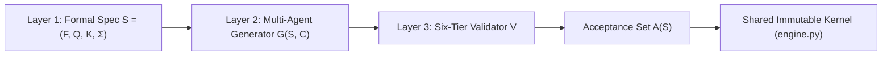
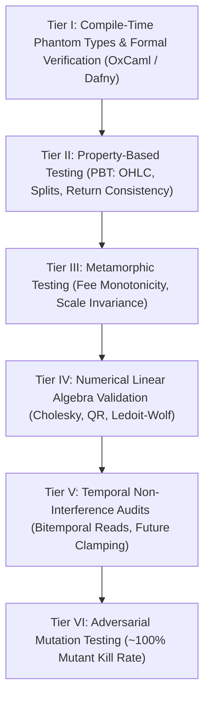

## Overview

As frontier AI models and agentic workflows surpass the average quantitative analyst in syntactic fluency and cross-language translation (synthesizing Python, C++, Rust, and OCaml in seconds), writing code has ceased to be the core bottleneck of quantitative finance. Instead, the profession has inverted: **specifying intent, verifying mathematical and temporal correctness, and governing non-deterministic execution** now define institutional edge and survival.

Between 2022 and 2026, generative tools compressed multi-hour research workflows into minutes (yielding a 2x–4x generation speedup and a 20%–30% net desk productivity lift). However, this velocity introduced severe systemic risks: **~70% of AI-generated trading scripts require manual debugging** due to idealized market assumptions, while a single unshifted column leak can artificially inflate a backtested Sharpe ratio from **0.59 to 5.07**. Consequently, elite quantitative institutions (Citadel, Jane Street, Millennium, Point72) have expanded quantitative headcount, reallocating human cognitive bandwidth from syntactic boilerplate to causal inference, formal specification, and adversarial verification.

## Structural Realignment: Direct Signal Prediction vs. Engineering Acceleration

Empirical practice across systematic hedge funds and market makers demonstrates an acute bifurcation between AI applications:

- **The Alpha Illusion (Failed Direct Forecasting):** Prompting LLMs directly with price time-series and news sentiment to predict asset returns consistently underperforms naive momentum or mean-reversion baselines net of transaction costs. Apparent in-sample backtest profitability is an artifact of pre-training memorization and survivorship bias baked into model weights.
- **Engineering and Infrastructure Accelerator (Proven Lift):** LLMs excel at cross-language translation, automating data ingestion parsers, and synthesizing academic literature into executable scaffolds within minutes.

### The Three Foundational Infrastructure Pillars

1. **Context Grounding:** Agents are bound directly to internal data catalogs, schema registries, and proprietary codebases, ensuring generated modules reflect firm-specific production environments rather than textbook snippets.
2. **Tool-Integrated Agents via MCP:** Replacing stateless chat with Model Context Protocol (MCP) servers enabling agents to query Apache Iceberg data lakes, run code in isolated sandboxes, and invoke automated validation testbenches.
3. **Stateful Air-Gapped Compute:** Private inference running on dedicated on-premise GPU clusters ensures proprietary intellectual property, order flow data, and tick histories never traverse public networks.

## Role Evolution Across the Quantitative Desk

Recruiting and daily operations at premier funds have shifted from testing rote algorithmic syntax to evaluating prompt specification, constrained reasoning, and verification under stress:

| Quantitative Role | Legacy Pre-AI Work Style (Pre-2023) | AI-Native Work Style (2026 Standard) | Primary Cognitive Bottleneck & Accountability |
|---|---|---|---|
| **Quantitative Researcher** | Writing boilerplate data parsers, coding backtesters from scratch, debugging syntax. | Authoring formal mathematical specs, tuning declarative agent YAMLs, auditing for p-hacking and look-ahead bias. | Distinguishing genuine economic causality from AI-accelerated curve-fitting and multiple-testing false discoveries. |
| **Quantitative Trader** | Hand-writing execution scripts, monitoring static alerts, manual order routing parameter tuning. | Supervising tiered AI-to-silicon pipelines, stress-testing broker error state machines, managing regime shifts. | Auditing live microstructure realities (variable spreads, partial fills, requotes, queue latency) omitted by AI. |
| **Risk Manager & Validator** | Periodic annual document reviews, static model re-derivations, paper-based model inventories. | Enforcing runtime behavioral telemetry, decomposing hybrid systems under SR 26-2, governing non-deterministic tool chains. | Bounding unbounded input spaces, preventing cascading agentic execution errors, maintaining version-pinned fallbacks. |

### Sealed Out-of-Sample Evaluation Protocol

To prevent multi-agent loops from industrializing p-hacking, researchers operate under sealed out-of-sample constraints:

$$
s_t = f(H_t) \quad [\text{Cryptographically Frozen Feature Set \& Source Code}]
$$

Autonomous research pipelines are granted a strict experimentation budget (e.g., maximum 5 revisions across an in-sample window) before their feature definitions and code are frozen and evaluated exactly once against an unexposed out-of-sample period, with zero feedback returned for tuning.

## Regulatory Perimeter Shift: Federal Reserve SR 26-2

Issued on **April 17, 2026** by the Federal Reserve, OCC, and FDIC to supersede the legacy SR 11-7 framework, **SR 26-2 (OCC Bulletin 2026-13)** establishes modern model risk perimeters:

- **Footnote 3 Exclusion:** SR 26-2 Footnote 3 expressly excludes generative AI and autonomous agentic workflows from traditional Model Risk Management (MRM) perimeters because their emergent outputs cannot be validated via static mathematical equations.
- **Continuous Behavioral Telemetry:** Replaces annual documentation reviews with continuous runtime behavioral monitoring across four distinct component classes:
  1. *Class 1 (In-Scope Models):* Statistical alpha and risk engines governed by classical conceptual soundness and independent validation.
  2. *Class 2 (Deterministic Rules):* Trading limits and order routing governed by strict software change controls.
  3. *Class 3 (Generative AI):* Prompts, RAG pipelines, and parsers evaluated for hallucination, source-level provenance, and prompt drift.
  4. *Class 4 (Agentic Systems):* Autonomous execution chains bounded by action-authority limits, version-pinned model fallbacks, and deterministic kill-switches.

## Specification-Driven Development (SDD)

When coding agents generate 500 lines of code in seconds, traditional human line-by-line review fails due to the **Productivity–Reliability Paradox** (clean syntax induces subconscious acceptance of flawed logic) and **Cognitive Debt** (atrophy of human mental models).

Quantitative engineering replaces conversational "vibe coding" with **Specification-Driven Development (SDD)**, where code is treated as disposable commodity and the formal specification is the sole source of truth:

$$
S = (F, Q, K, \Sigma)
$$

- **$F$ (Functional & Economic Semantics):** Precise mathematical definitions of universe selection, point-in-time signal calculations, state vs. event triggers, sizing formulas, and rebalance schedules.
- **$Q$ (Quality & Numerical Attributes):** Floating-point precision bounds, matrix condition number tolerances, execution latency budgets, and missing-data imputation policies.
- **$K$ (Constitutional Risk & Regulatory Constraints):** Maximum gross/net leverage caps ($L_{\max}$), drawdown limits, venue spread thresholds, and data lineage contracts.
- **$\Sigma$ (Architectural Interface Contracts):** Structural invariants forbidding unauthorized network access, unapproved library imports, or mutable global state.

### The Shared Immutable Engine Core (`engine.py`)

AI agents are strictly forbidden from writing backtest accounting or execution-timing engines. Agent code emits solely target portfolio weights or scores $s_t = f(H_t)$ at epoch $t$. An immutable, human-verified core (`engine.py`) enforces:
1. A deterministic 1-session execution lag (signals at day $t$ close earn returns starting at day $t+1$).
2. Natural portfolio weight drift between rebalance dates.
3. Standardized transaction costs and slippage models.

## The Six-Tier Verification Arsenal

Because standard unit tests only verify edge cases anticipated by the developer, institutional quants employ a six-tier automated verification ladder:

### Tier I: Compile-Time Type Contracts & Formal Verification
- **Newtypes & Branded Types:** Enforces distinct types for `Price`, `Quantity`, and `UnixNanos` to eliminate dimensional unit bugs at compile time.
- **Phantom Types:** Encodes state transitions directly into types (`UnvalidatedOrder` $\to$ `RiskCheckedOrder` $\to$ `SubmittedOrder`), making illegal order submissions a compilation failure.
- **Veri-Coding (OxCaml & Dafny):** Agents synthesize machine-checkable mathematical proofs of pre- and post-conditions alongside executable code.

### Tier II: Property-Based Testing (PBT)
Executes 500+ randomized synthetic market scenarios asserting mathematical invariants:
- OHLC Bar Consistency: $\text{low} \le \text{open} \le \text{high}$ and $\text{low} \le \text{close} \le \text{high}$.
- Timestamp Monotonicity: $t_i > t_{i-1}$.
- Single-Buy Turnover Conservation: A 100% single-asset buy held without rebalancing must yield total lifetime turnover of exactly 1.0000.

### Tier III: Metamorphic Testing
Resolves the **Quantitative Oracle Problem** (where the true out-of-sample Sharpe ratio is unknown) by asserting relational invariance across transformed inputs $T(x)$:
- **Fee Monotonicity MR:** $c_2 > c_1 \implies \text{Perf}(S, c_2) \le \text{Perf}(S, c_1)$.
- **Scale Invariance MR:** Multiplying capital by $\alpha > 0$ preserves Sharpe, Sortino, and percentage drawdown.
- **Periodic Boundary MR:** In derivative PDE solvers, spatial coordinate shifts $x' = x + \pi$ preserve surface valuations.

### Tier IV: Numerical Linear Algebra Validation
Guards against the **Markowitz Curse** where empirical covariance matrices in large asset universes ($N > T_{lb}$) become ill-conditioned ($\kappa(X^T X) = \kappa(X)^2$):
- Rejects explicit matrix inversions (`np.linalg.inv`) in favor of Cholesky factorization ($\Sigma = L L^T$) and QR decomposition.
- Implements Ledoit-Wolf or Quadratic-Inverse Shrinkage (QIS) with an eigenvalue floor clamped at $10^{-10}$.
- Enforces deterministic Equal-Weight ($w_{\text{EW}}$) crisis fallbacks if optimization fails.

### Tier V: Eradicating Look-Ahead Bias (Temporal Non-Interference)
Formalized by Fonseca (arXiv:2607.04958), look-ahead bias is an information-flow violation across bitemporal coordinates:
- Restricts AI code to value-independent availability fragments certified by type-and-effect systems.
- Employs an **Adversarial Future-Mutation Oracle**: applies aggressive synthetic mutations (zeroing future volume, clamping future price changes, injecting extreme spikes) to data for $t > T$ and asserts that output signals up to time $T$ remain byte-identical:

$$
M_T(D)|_{\mathcal{F}_T} = D|_{\mathcal{F}_T} \implies A_T(M_T(D)) \equiv A_T(D)
$$

### Tier VI: Adversarial Mutation Testing of AI Test Suites
Tests the validity of the tests themselves to prevent tautological test coverage:
- **Conjunct-Dropping Operators:** Individually removes sub-conditions from compound boolean guards (e.g., `spread <= max and vol < vol_cap`) to ensure every clause is pinned by a failing test.
- **Three-Point Boundary Pinning:** Enforces on-boundary validity, immediate 1-tick refusal, and standalone literal constant pinning to prevent silent parameter drift.

## Institutional Governance: The 5-Stage CI Verification Gate

All AI-generated code is treated as untrusted external user input and must pass an automated five-stage continuous integration pipeline before human review:

1. **Stage 1 (Static AST):** Certifies value-independent availability and type-and-effect temporal non-interference.
2. **Stage 2 (Linear Algebra Lint):** Rejects unregularized matrix inversions, non-PSD covariances, and normal equations.
3. **Stage 3 (500+ PBT & MR Runs):** Validates OHLC consistency, fee monotonicity, and scale invariance under randomized stress inputs.
4. **Stage 4 (Mutation Scoring):** Asserts byte-identical future-mutation invariance and achieves a ~100% mutant kill rate.
5. **Stage 5 (Human 5-Date Audit):** Spot-audits five historical chart dates (macro releases, volatility spikes, exchange halts) to manually verify order execution logs.

## Related Reading

- [The Post-Syntax Quantitative Paradigm: Role Evolution, Adversarial Verification, and Governance When AI Surpasses Human Coding](/articles/post-syntax-quant-paradigm-adversarial-verification)
- [Full Research Paper](https://docs.google.com/document/d/e/2PACX-1vRaC1_qx-O3O0B6dJwTmPEWDOLRCExhgpoar4HllMFExgmMtH7clSLCDvIjxDboddEk7X-2n2wipYAp/pub)
